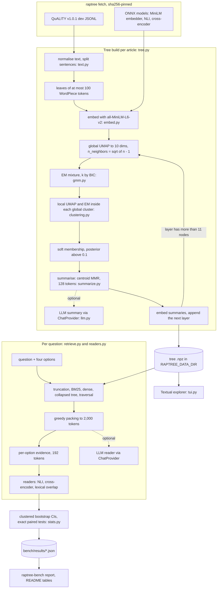

# raptor-tree-retrieval

This project builds RAPTOR summary trees over the long stories in
[QuALITY](https://github.com/nyu-mll/quality). It then tests one question: if every method
gets the same 2,000-token context, does retrieving from the tree beat retrieving flat chunks?

The tree is built the way the RAPTOR paper describes. Sentences are grouped into leaves and
embedded. UMAP reduces the embeddings, and a Gaussian mixture fitted by EM (with k chosen by BIC)
clusters them. Each cluster is summarised, and the summaries become the next layer. The mixture
model, the two-stage clustering, the summariser, the token-budget packing, the beam traversal,
the readers and the statistics are all implemented in this repository; scikit-learn appears only
in the tests, as a reference. A terminal UI shows any tree layer by layer and marks the nodes
each method retrieved for a question.

The walkthrough below follows one story through the whole pipeline. The benchmark tables come at
the end. They are **pending benchmark**: the full run has not happened yet.

## Try it without downloading anything

The bundled sample story and the `offline` profile (hashing embedder, PCA instead of UMAP) need
no data and no models:

```bash
uv sync
uv run raptree demo
```

`demo` builds a tree for the sample story, checks that every leaf can be reached from the top
layer, and prints what each of the five retrieval methods would put into a 400-token context.
The same command is the default of the Docker image (`docker run --rm raptree`).

## Walkthrough: "Captain Chaos", one layer at a time

The story is article 62139 of QuALITY dev, *Captain Chaos* by Nelson S. Bond (Planet Stories,
1942). The Project Gutenberg transcriber found no record that its US copyright was renewed.
Every screen below is the verbatim output of `uv run raptree-bench walkthrough`, stored in
[`bench/results/walkthrough-62139.json`](bench/results/walkthrough-62139.json) together with the
machine, date, git commit and command. Captured on an Intel i5-8500 (6 cores, 12 GB RAM),
Windows 10, CPU only, on 2026-10-12 (git 498bbb0).

### Step 1. Fetch QuALITY and the three ONNX models

```bash
uv run raptree fetch
```

This downloads about 108 MB and checks the size and sha256 of every file against the values
pinned in [`src/raptree/sources.py`](src/raptree/sources.py). QuALITY v1.0.1 dev (8.8 MB) is
taken from the official GitHub repository at a fixed commit and stored under
`$RAPTREE_DATA_DIR`, which defaults to `~/.cache/raptor-tree-retrieval`. The models are taken
from the Hugging Face Hub at fixed revisions and stored in the Hugging Face cache (`$HF_HOME`):

| Role | Model | File | Licence |
|---|---|---|---|
| Sentence embeddings, token counting | `sentence-transformers/all-MiniLM-L6-v2` | `onnx/model_quint8_avx2.onnx` (23 MB) | Apache-2.0 |
| NLI reader | `MoritzLaurer/xtremedistil-l6-h256-zeroshot-v1.1-all-33` | `onnx/model.onnx` (51 MB) | MIT |
| Cross-encoder reader | `cross-encoder/ms-marco-MiniLM-L6-v2` | `onnx/model_quint8_avx2.onnx` (23 MB) | Apache-2.0 |

### Step 2. Build the tree

```bash
uv run raptree build 62139
```

`build` saves the tree to `$RAPTREE_DATA_DIR/trees/onnx/62139.npz` and lists its layers, top
layer first. `uv run raptree show <tree.npz>` prints the same listing for any saved tree:

```text
Captain Chaos [62139]
362 sentences, 6681 tokens (wordpiece:all-MiniLM-L6-v2), summaries by extractive-mmr(max_tokens=128,diversity=0.3)
layer 2: 3 nodes
  #92    127 tok  4 children   I said, "The blockade, sir? "We are to attempt to run the Outer Pla...
  #93    123 tok  4 children   And whatever failings "Captain Slops" might have, he had not exagge...
  #94    127 tok  6 children   So, getting desperate, I audioed a plaintive appeal to the wealthy ...
layer 1: 14 nodes
  #78    126 tok  4 children   "Get below instantly, or by the lavendar lakes of Luna I'll—" "If I...
  #79    124 tok  6 children   When I was turning to leave he said apologetically, "I didn't mean ...
  #80    125 tok  7 children   And whatever failings "Captain Slops" might have, he had not exagge...
  #81    128 tok  7 children   "We are to attempt to run the Outer Planets Alliance blockade at an...
  #82    126 tok  3 children   From oil-soaked old Jock McMurtrie, the Chief Engineer, all the way...
  #83    128 tok  10 children  There's an old Nolan heat-cannon rusting in the storeroom. The way ...
  ... 8 more
layer 0: 78 nodes
  #0      88 tok  leaf         CAPTAIN CHAOS By NELSON S. BOND The Callisto-bound Leo needed a coo...
  #1      79 tok  leaf         Not Phoebus or Phoebe; I mean Phobos, Mars' inner moon. Our regular...
  #2      77 tok  leaf         So we laid the Leo down on Phobos' tiny cradle-field and bundled ou...
  #3      66 tok  leaf         In those days, Phobos had only a handful of settlers, and most of t...
  #4      94 tok  leaf         And, of course, cooks are dime-a-dozen when you don't need one, but...
  #5      99 tok  leaf         So, getting desperate, I audioed a plaintive appeal to the wealthy ...
  ... 72 more
```

The article was split into 362 sentences and packed, in order, into 78 leaves
of at most 100 WordPiece tokens each (layer 0). The first clustering pass grouped the leaves into
14 clusters, and each cluster got a summary node (layer 1). A second pass grouped those into
3 (layer 2). Building stops there because a layer with 11 nodes or fewer is too small to
cluster in 10 dimensions, the same rule RAPTOR uses.

Each pass works in two stages. UMAP first reduces the whole layer to 10 dimensions with
`n_neighbors = sqrt(n - 1)`. [`gmm.py`](src/raptree/gmm.py) then fits a full-covariance mixture
for every k from 1 to 50 (fewer for small layers) and keeps the k with the lowest BIC. Each of
these global clusters is reduced and clustered again with 10 neighbours. Assignment is soft: a
node joins every cluster whose posterior is above 0.1, so one passage can feed two summaries. A
cluster whose members add up to more than 3,500 tokens is split again.

The summaries are extractive. Within each cluster, maximal marginal relevance picks sentences
close to the cluster centroid and different from each other, until 128 tokens are used. The
sentences are copied verbatim and kept in article order.
[ADR 2](docs/adr/0002-extractive-summaries-for-the-measured-tree.md) explains why the measured
tree does not use LLM summaries.

### Step 3. Open the top layer

```bash
uv run raptree tui ~/.cache/raptor-tree-retrieval/trees/onnx/62139.npz
```

```text
 ⭘                          raptree — Captain Chaos · raptor-collapsed
╭──────────────────────────────────────────────────────────╮╭──────────────────────────────────────╮
│▼ Captain Chaos · nodes per layer 3/14/78                 ││ Captain Chaos                        │
│├── ▶     L2 #92   127 tok  4 ch  I said, "The blockade, s││ 362 sentences, 95 nodes, 3 layers    │
│├── ▶     L2 #93   123 tok  4 ch  And whatever failings "C││ built with                           │
│└── ▶     L2 #94   127 tok  6 ch  So, getting desperate, I││ all-MiniLM-L6-v2-onnx-quint8,        │
│                                                          ││ umap,                             ▇▇ │
│                                                          ││ extractive-mmr(max_tokens=128,dive   │
│                                                          ││ rsity=0.3)                           │
│                                                          │╰──────────────────────────────────────╯
│                                                          │╭──────────────────────────────────────╮
│                                                          ││ Q1 What is the most likely meaning   │
│                                                          ││ of the slang O.Q.? (in               │
│                                                          ││ twentieth-century American           │
╰──────────────────────────────────────────────────────────╯╰──────────────────────────────────────╯
 m Method  e Expand a level  c Collapse  q Quit
```

The left pane is the tree, top layer first. Each row shows the layer, node id, token count,
number of children and the start of the text. The right pane shows details for the node under
the cursor, and below it the article's questions. `e` expands one more level, `c` collapses,
`m` switches the retrieval method, and Enter on a question runs retrieval.

### Step 4. One level down

```text
 ⭘                          raptree — Captain Chaos · raptor-collapsed
╭──────────────────────────────────────────────────────────╮╭──────────────────────────────────────╮
│▼ Captain Chaos · nodes per layer 3/14/78                 ││ Captain Chaos                        │
│├── ▼     L2 #92   127 tok  4 ch  I said, "The blockade, s││ 362 sentences, 95 nodes, 3 layers    │
││   ├── ▶     L1 #81   128 tok  7 ch  "We are to attempt t││ built with                           │
││   ├── ▶     L1 #82   126 tok  3 ch  From oil-soaked old ││ all-MiniLM-L6-v2-onnx-quint8, umap,  │
││   ├── ▶     L1 #85   128 tok  5 ch  Makeshift meals are ││ extractive-mmr(max_tokens=128,divers │
││   └── ▶     L1 #89   121 tok  3 ch  Officers Wainwright ││ ity=0.3)                             │
│├── ▼     L2 #93   123 tok  4 ch  And whatever failings "C││                                      │
││   ├── ▶     L1 #80   125 tok  7 ch  And whatever failing││ e expands a level, m changes the     │
││   ├── ▶     L1 #88   124 tok  5 ch  "Well, Andy Laney," ││ retrieval method,                    │
││   ├── ▶     L1 #90   127 tok  8 ch  He rang the bell tha││ Enter on a question highlights what  │
││   └── ▶     L1 #91   126 tok  4 ch  "I was planning a sp││ that method retrieves.               │
│└── ▼     L2 #94   127 tok  6 ch  So, getting desperate, I│╰──────────────────────────────────────╯
│    ├── ▶     L1 #78   126 tok  4 ch  "Get below instantly│╭──────────────────────────────────────╮
│    ├── ▶     L1 #79   124 tok  6 ch  When I was turning t││ Q1 What is the most likely meaning   │
│    ├── ▶     L1 #83   128 tok 10 ch  There's an old Nolan││ of the slang O.Q.? (in               │
│    ├── ▶     L1 #84   127 tok  4 ch  "Vesta!" he piped in││ twentieth-century American           │
│    ├── ▶     L1 #86   127 tok  7 ch  We picked up our new││ English)                             │
│    └── ▶     L1 #87   128 tok  5 ch  And, of course, cook││ Q2 Why does the Skipper stop         │
╰──────────────────────────────────────────────────────────╯╰──────────────────────────────────────╯
 m Method  e Expand a level  c Collapse  q Quit
```

The 3 top nodes divide the 14 layer-1 summaries between them. This split is a partition,
but it does not have to be: soft assignment can place a node under two parents.

### Step 5. From a summary back to the article

Moving the cursor to node #84 shows where its text comes from:

```text
 ⭘                          raptree — Captain Chaos · raptor-collapsed
╭──────────────────────────────────────────────────────────╮╭──────────────────────────────────────╮
│▼ Captain Chaos · nodes per layer 3/14/78                 ││ L1 #84 · 127 tokens                  │
│├── ▶     L2 #92   127 tok  4 ch  I said, "The blockade, s││ summary of 4 children: 19, 50,       │
│├── ▶     L2 #93   123 tok  4 ch  And whatever failings "C││ 62-63                                │
│└── ▼     L2 #94   127 tok  6 ch  So, getting desperate, I││ covers leaves 19, 50, 62-63 (4 of    │
│    ├── ▶     L1 #78   126 tok  4 ch  "Get below instantly││ 78, 5%)                              │
│    ├── ▶     L1 #79   124 tok  6 ch  When I was turning t││ parents: #94                      ▇▇ │
│    ├── ▶     L1 #83   128 tok 10 ch  There's an old Nolan││ 8 sentences, all copied verbatim     │
│    ├── ▶     L1 #84   127 tok  4 ch  "Vesta!" he piped in││ from the article                     │
│    ├── ▶     L1 #86   127 tok  7 ch  We picked up our new││                                      │
│    └── ▶     L1 #87   128 tok  5 ch  And, of course, cook││ "Vesta!" he piped in that            │
│                                                          ││ curiously high-pitched and mellow    │
│                                                          │╰──────────────────────────────────────╯
│                                                          │╭──────────────────────────────────────╮
│                                                          ││ Q1 What is the most likely meaning   │
│                                                          ││ of the slang O.Q.? (in               │
│                                                          ││ twentieth-century American           │
│                                                          ││ English)                             │
│                                                          ││ Q2 Why does the Skipper stop         │
╰──────────────────────────────────────────────────────────╯╰──────────────────────────────────────╯
 m Method  e Expand a level  c Collapse  q Quit
```

Node #84 summarises leaves 19, 50, 62 and 63. These passages come from different parts of the
story, so clustering by meaning, not position, brought them together. That is what a summary
layer adds over flat chunks. Its 8 sentences are copied from those leaves. Every line in any
retrieved context can therefore be traced back to character offsets in the article.

### Step 6. Ask a question with the collapsed tree

Question 7 is one of QuALITY's *hard* questions. The annotators who had only 45 seconds with the
text mostly got it wrong. Selecting it highlights what the collapsed-tree method retrieves:

```text
 ⭘                          raptree — Captain Chaos · raptor-collapsed
╭──────────────────────────────────────────────────────────╮╭──────────────────────────────────────╮
│▼ Captain Chaos · nodes per layer 3/14/78                 ││ raptor-collapsed: 19 nodes, 1978     │
│├── ▼     L2 #92   127 tok  4 ch  I said, "The blockade,  ││ of 2000 tokens (L2×2, L1×5, L0×12)   │
││   ├── ▼     L1 #81   128 tok  7 ch  "We are to attempt  ││                                      │
││   │   ├──     L0 #8    100 tok  leaf  My orders were t  ││ Why was the new cook so upset that   │
││   │   ├──     L0 #9     74 tok  leaf  "If this is true  ││ the Skipper decided to surrender?    │
││   │   ├──     L0 #10    86 tok  leaf  A chance to end   ││   A. He realized that if they        │
││   │   ├──     L0 #61    95 tok  leaf  There's a double  ││ surrendered they would be sent to    │
││   │   ├──     L0 #75    91 tok  leaf  Maybe they'll se  ││ concentration camps and he would     │
││   │   ├── ● 8 L0 #76    90 tok  leaf  He had been righ  ││ no longer be able to continue        │
││   │   └──     L0 #77    88 tok  leaf  Our secret would  ││ cooking.                             │
││   ├── ▶     L1 #82   126 tok  3 ch  From oil-soaked ol  ││   B. He realized that Skipper was    │
││   ├── ▶ ●13 L1 #85   128 tok  5 ch  Makeshift meals ar  ││ more devoted to his own survival     │
││   └── ▶     L1 #89   121 tok  3 ch  Officers Wainwrigh  ││ than to the Federation.              │
│├── ▼ ● 7 L2 #93   123 tok  4 ch  And whatever failings   ││   C. He spent his whole life in      │
││   ├── ▼     L1 #80   125 tok  7 ch  And whatever faili▁▁││ the Belt and he wanted to            │
││   │   ├──     L0 #28    93 tok  leaf  Never did have n  ││ experience his first space fight. ▇▇ │
││   │   ├── ● 3 L0 #29    83 tok  leaf  He was busy prep  ││ * D. He realized by surrendering,    │
││   │   ├── ● 2 L0 #41    96 tok  leaf  Maybe I was mist  ││ the Alliance could use their ship    │
││   │   ├──     L0 #51    71 tok  leaf  That period of j  ││ to sneak into Federation territory   │
││   │   ├──     L0 #52    99 tok  leaf  One of the rough  │╰──────────────────────────────────────╯
││   │   ├──     L0 #54    94 tok  leaf  "Yeah!" snorted   │╭──────────────────────────────────────╮
││   │   └── ●19 L0 #56    94 tok  leaf  More than once d  ││ Q1 What is the most likely meaning   │
││   ├── ▼ ●12 L1 #88   124 tok  5 ch  "Well, Andy Laney,  ││ of the slang O.Q.? (in            ▂▂ │
││   │   ├──     L0 #13    95 tok  leaf  "Well," he repea  ││ twentieth-century American           │
││   │   ├── ●15 L0 #14    76 tok  leaf  The Old Man's li  ││ English)                             │
││   │   ├── ● 9 L0 #15    90 tok  leaf  Do I get the job  ││ Q2 Why does the Skipper stop         │
││   │   ├──     L0 #16    94 tok  leaf  "You're willing   ││ abruptly after he says "when         │
││   │   └──     L0 #27    42 tok  leaf  Blinky Todd, an   ││ you're running a blockade"?          │
││   ├── ▼     L1 #90   127 tok  8 ch  He rang the bell t  ││ Q3 Who or what is Leo?               │
││   │   ├──     L0 #11    48 tok  leaf  So we must find   ││ Q4 Why does the Skipper allow the    │
╰──────────────────────────────────────────────────────────╯╰──────────────────────────────────────╯
 m Method  e Expand a level  c Collapse  q Quit
```

The collapsed tree treats all 95 nodes as one pool. The retrieval query is the question
plus its four options, and every node is ranked by cosine similarity to it. Nodes are then taken
in rank order while they fit into 2,000 tokens; a node that does not fit is skipped, not treated
as the end ([ADR 4](docs/adr/0004-wordpiece-budget-and-skip-packing.md)). Here 19 nodes fit, 7 of
them summaries from both upper layers. A rank marker such as `●13` sits next to each retrieved
node, and the path to every retrieved node is expanded.

### Step 7. The same question by beam traversal

Pressing `m` switches to traversal:

```text
 ⭘                          raptree — Captain Chaos · raptor-traversal
╭──────────────────────────────────────────────────────────╮╭──────────────────────────────────────╮
│▼ Captain Chaos · nodes per layer 3/14/78                 ││ raptor-traversal: 20 nodes, 1979     │
│├── ▶ ● 3 L2 #92   127 tok  4 ch  I said, "The blockade,  ││ of 2000 tokens (L2×3, L1×3, L0×14)   │
│├── ▼ ● 1 L2 #93   123 tok  4 ch  And whatever failings   ││                                      │
││   ├── ▶     L1 #80   125 tok  7 ch  And whatever faili  ││ Why was the new cook so upset that   │
││   ├── ▼ ● 6 L1 #88   124 tok  5 ch  "Well, Andy Laney,  ││ the Skipper decided to surrender?    │
││   │   ├── ●19 L0 #13    95 tok  leaf  "Well," he repea  ││   A. He realized that if they        │
││   │   ├── ●11 L0 #14    76 tok  leaf  The Old Man's li  ││ surrendered they would be sent to    │
││   │   ├── ●10 L0 #15    90 tok  leaf  Do I get the job  ││ concentration camps and he would     │
││   │   ├── ●15 L0 #16    94 tok  leaf  "You're willing   ││ no longer be able to continue        │
││   │   └──     L0 #27    42 tok  leaf  Blinky Todd, an   ││ cooking.                             │
││   ├── ▶     L1 #90   127 tok  8 ch  He rang the bell t  ││   B. He realized that Skipper was    │
││   └── ▶     L1 #91   126 tok  4 ch  "I was planning a   ││ more devoted to his own survival     │
│└── ▼ ● 2 L2 #94   127 tok  6 ch  So, getting desperate,  ││ than to the Federation.              │
│    ├── ▶     L1 #78   126 tok  4 ch  "Get below instant  ││   C. He spent his whole life in      │
│    ├── ▶     L1 #79   124 tok  6 ch  When I was turning  ││ the Belt and he wanted to            │
│    ├── ▶     L1 #83   128 tok 10 ch  There's an old Nol  ││ experience his first space fight. ▇▇ │
│    ├── ▶     L1 #84   127 tok  4 ch  "Vesta!" he piped   ││ * D. He realized by surrendering,    │
│    ├── ▼ ● 4 L1 #86   127 tok  7 ch  We picked up our n  ││ the Alliance could use their ship    │
│    │   ├── ●12 L0 #0     88 tok  leaf  CAPTAIN CHAOS By  ││ to sneak into Federation territory   │
│    │   ├──     L0 #1     79 tok  leaf  Not Phoebus or P  │╰──────────────────────────────────────╯
│    │   ├── ●13 L0 #2     77 tok  leaf  So we laid the L  │╭──────────────────────────────────────╮
│    │   ├── ●17 L0 #3     66 tok  leaf  In those days, P  ││ Q1 What is the most likely meaning   │
│    │   ├── ● 9 L0 #5     99 tok  leaf  So, getting desp  ││ of the slang O.Q.? (in            ▂▂ │
│    │   ├── ● 8 L0 #25    90 tok  leaf  From now on, sup  ││ twentieth-century American           │
│    │   └── ●20 L0 #30    86 tok  leaf  When it comes to  ││ English)                             │
│    └── ▼ ● 5 L1 #87   128 tok  5 ch  And, of course, co  ││ Q2 Why does the Skipper stop         │
│        ├──     L0 #4     94 tok  leaf  And, of course,   ││ abruptly after he says "when         │
│        ├── ● 7 L0 #6     98 tok  leaf  The skipper scow  ││ you're running a blockade"?          │
│        ├── ●18 L0 #17    90 tok  leaf  Well, my fine yo  ││ Q3 Who or what is Leo?               │
│        ├── ●16 L0 #21    97 tok  leaf  For one thing, t▇▇││ Q4 Why does the Skipper allow the    │
╰──────────────────────────────────────────────────────────╯╰──────────────────────────────────────╯
 m Method  e Expand a level  c Collapse  q Quit
```

Traversal starts at the top layer. It keeps the best `beam` = 3 nodes, then the best 3 of their
children, and so on down. The leaves under the final beam fill the rest of the budget. With only
3 nodes at the top, the beam here keeps every top node. The selection happens one layer
down, where it keeps #88, #86 and #87, and the leaves are drawn from those three subtrees.

### Step 8. What a reader does with a context

The TUI stops at retrieval. The benchmark goes on to answer the question without an LLM
([ADR 3](docs/adr/0003-llm-free-readers-over-per-option-evidence.md)). For each option it takes
the sentences of the retrieved context most similar to "question + option", up to 192 tokens.
A pair model then scores that evidence against the option: an NLI model (entailment log-odds) or
an MS MARCO cross-encoder (relevance logit). A lexical-overlap scorer serves as a third,
model-free reader. The highest-scoring option is the answer. Every method's context goes
through the same evidence step. A no-context control shows how much each reader gets from the
options alone.

### Step 9. All 115 articles

```bash
uv run raptree-bench run
uv run raptree-bench report bench/results/quality-dev-2k.json
```

`run` builds the tree for every dev article and saves it next to the one above, so `raptree tui`
can open any of them. It retrieves with all five methods for all 2,086 questions, reads with all
three readers and writes `bench/results/quality-dev-2k.json`. The per-question predictions go
next to it in a `.predictions.jsonl` file. `report` prints the Markdown tables that are copied
into the next section. Runs limited with `--limit-articles` or `--limit-questions` must write to
a `smoke-*.json` file, so a partial run cannot replace the headline results.

## How the pieces connect



## Results on QuALITY dev

> **Pending benchmark.** Every cell below is filled from `bench/results/quality-dev-2k.json`
> by `raptree-bench report` once the full run has finished on the machine named here.

Measured on: Intel i5-8500 (6 cores, 12 GB RAM), Windows 10, CPU only. Date: pending benchmark.
Command: `uv run raptree-bench run`.

The setup: 2,000 WordPiece tokens of context per question for every method, trees as built
above, and chance at 25%. *Hard* is QuALITY's own difficulty flag. Intervals are 95% bootstrap
intervals that resample whole articles
([ADR 5](docs/adr/0005-article-clustered-intervals-and-exact-paired-tests.md)).

### Accuracy with the NLI reader

| Context | All | 95% CI | Hard | 95% CI | Easy | 95% CI |
|---|---:|---|---:|---|---:|---|
| First 2K tokens | pending benchmark | | | | | |
| BM25 top-k | pending benchmark | | | | | |
| Dense top-k | pending benchmark | | | | | |
| RAPTOR collapsed | pending benchmark | | | | | |
| RAPTOR traversal | pending benchmark | | | | | |
| No context (options only) | pending benchmark | | | | | |

### Accuracy with the cross-encoder reader

| Context | All | 95% CI | Hard | 95% CI | Easy | 95% CI |
|---|---:|---|---:|---|---:|---|
| First 2K tokens | pending benchmark | | | | | |
| BM25 top-k | pending benchmark | | | | | |
| Dense top-k | pending benchmark | | | | | |
| RAPTOR collapsed | pending benchmark | | | | | |
| RAPTOR traversal | pending benchmark | | | | | |
| No context (options only) | pending benchmark | | | | | |

### Accuracy with the lexical-overlap reader

| Context | All | 95% CI | Hard | 95% CI | Easy | 95% CI |
|---|---:|---|---:|---|---:|---|
| First 2K tokens | pending benchmark | | | | | |
| BM25 top-k | pending benchmark | | | | | |
| Dense top-k | pending benchmark | | | | | |
| RAPTOR collapsed | pending benchmark | | | | | |
| RAPTOR traversal | pending benchmark | | | | | |
| No context (options only) | pending benchmark | | | | | |

### Is the collapsed tree better than each alternative?

Exact paired sign-flip tests on per-question correctness, Holm-adjusted over the 15 pairs per
reader.

| Reader | A | B | A - B (points) | only A right | only B right | p | p (Holm) |
|---|---|---|---:|---:|---:|---:|---:|
| NLI | RAPTOR collapsed | each other context | pending benchmark | | | | |
| cross-encoder | RAPTOR collapsed | each other context | pending benchmark | | | | |
| lexical overlap | RAPTOR collapsed | each other context | pending benchmark | | | | |

### What each method put into the context

| Context | Mean tokens | Distinct-sentence tokens | Nodes | From summaries | Latency p50 (ms) | p90 (ms) |
|---|---:|---:|---:|---:|---:|---:|
| First 2K tokens | pending benchmark | | | | | |
| BM25 top-k | pending benchmark | | | | | |
| Dense top-k | pending benchmark | | | | | |
| RAPTOR collapsed | pending benchmark | | | | | |
| RAPTOR traversal | pending benchmark | | | | | |

### Building the trees

| Per article | Mean | Median | p90 | Max |
|---|---:|---:|---:|---:|
| Build seconds | pending benchmark | | | |
| Nodes per tree | pending benchmark | | | |
| Leaves per tree | pending benchmark | | | |
| Article tokens | pending benchmark | | | |

Tree depth histogram, stage totals and reader throughput: pending benchmark.

### Not run

| Configuration | Status | Why |
|---|---|---|
| RAPTOR with LLM-written summaries | not run | needs an LLM endpoint; the extractive summariser was measured instead |
| LLM reader over the full 2,000-token context | not run | needs an LLM endpoint; only the LLM-free readers were measured |

Both are implemented and wired to the command line (see
[Pointing it at an LLM](#pointing-it-at-an-llm)). No number in this README comes from them.

## What these results can and cannot say

- **Extractive summaries test selection, not synthesis.** A summary node here can only bring
  existing sentences together. If the collapsed tree beats dense retrieval, clustered selection
  helped. If it does not, the result says nothing about RAPTOR's abstractive summaries, which
  were not run.
- **The readers are weak.** Small NLI and cross-encoder models with 192 tokens of evidence per
  option will score close to chance on QuALITY, especially on the hard subset. The comparison
  that matters is between contexts for the same reader, not the absolute level. These numbers
  cannot be set beside the paper's GPT-4 accuracies.
- **The evidence step narrows the differences.** All methods pass through the same per-option
  selection of 192 tokens, so a context that holds more relevant sentences only helps when those
  sentences survive that cut.
- **The paired tests ignore article clustering.** The sign-flip test treats questions as
  independent, so its p-values are screening numbers. The bootstrap intervals do resample
  whole articles.
- **Tokens are WordPiece tokens.** The 2,000-token budget is counted with the MiniLM tokenizer.
  An LLM's tokenizer would count the same context differently.
- **The trees are shallow.** With roughly 30 to 80 leaves per article and RAPTOR's stopping rule,
  articles get two or three layers. The depth histogram in the results shows the split.
- **One machine, CPU only.** Timings come from one Windows 10 desktop, and latencies cover
  retrieval only (query embedding is reported separately).

## Pointing it at an LLM

Every LLM step goes through `ChatProvider` in [`llm.py`](src/raptree/llm.py). It has an
OpenAI-compatible adapter (OpenAI, Ollama, vLLM and LM Studio all serve `/v1/chat/completions`)
and a deterministic fake that the tests use.

```bash
export RAPTREE_LLM_BASE_URL=http://localhost:11434/v1   # e.g. a local Ollama
export RAPTREE_LLM_MODEL=<model name the server knows>
export RAPTREE_LLM_API_KEY=...                          # only if the server wants one
uv run raptree build 62139 --summarizer llm --out llm-62139.npz
uv run raptree-bench run --summarizer llm --readers nli,cross-encoder,overlap,llm \
    --out bench/results/quality-dev-2k-llm.json
```

`--llm fake` swaps in the fake provider. The results file then lists "any real LLM" under
`not_run`, and the headline file refuses such a run.

## Running it in Docker

The image holds the package and its runtime dependencies only. Data, models and trees go to a
volume mounted at `/data`:

```bash
docker build -t raptree .
docker run --rm raptree                                      # offline demo
docker run --rm -v raptree-data:/data raptree fetch
docker run --rm -v raptree-data:/data raptree build 62139
docker run --rm -it -v raptree-data:/data raptree tui /data/trees/onnx/62139.npz
```

It runs as uid 10001 and has no compiler. CI builds it and runs the demo and a headless TUI
capture inside it.

## Tests

```bash
uv run pytest                  # default suite: fixtures and fakes, no network
uv run pytest -m integration   # needs `raptree fetch`; skipped when the files are missing
uv run ruff check . && uv run ruff format --check .
```

The default suite checks the following:

- EM against scikit-learn from the same starting point (parameters, log-likelihood, BIC,
  responsibilities).
- Hypothesis properties: the log-likelihood never decreases, packing never exceeds the budget,
  and the exact p-value equals the sign test.
- BIC recovers the planted k.
- Tree invariants: every leaf is reachable, provenance covers exactly the children's leaves, and
  extractive summaries are verbatim and within budget.
- LLM summaries and the LLM reader, run through the fake provider.
- The TUI, driven headless by Textual's pilot and compared with text snapshots.
- The benchmark end to end on a three-line QuALITY-format fixture.

## Where the text and the weights come from

| Item | Source | Licence | In this repository? |
|---|---|---|---|
| QuALITY v1.0.1 questions and annotations | [nyu-mll/quality](https://github.com/nyu-mll/quality), file `QuALITY.v1.0.1.htmlstripped.dev` at a pinned commit | CC BY 4.0 | No, fetched |
| QuALITY dev article texts: 86 fiction stories | Project Gutenberg | Project Gutenberg licence (public domain in the US) | No, fetched |
| QuALITY dev article texts: 19 magazine articles | Slate, via the Open American National Corpus | OANC licence | No, fetched |
| QuALITY dev article texts: 10 other articles | The Long+Short, MIT Press open access, Freesouls | CC BY 4.0 | No, fetched |
| all-MiniLM-L6-v2 (ONNX, int8) | Hugging Face, pinned revision | Apache-2.0 | No, fetched |
| xtremedistil-l6-h256-zeroshot-v1.1-all-33 (ONNX) | Hugging Face, pinned revision | MIT | No, fetched |
| ms-marco-MiniLM-L6-v2 (ONNX, int8) | Hugging Face, pinned revision | Apache-2.0 (trained on MS MARCO, whose terms restrict use to non-commercial research) | No, fetched |
| "The Last Keeper of Gull Rock" sample story and its questions | written for this repository | MIT, with the code | Yes |

The walkthrough quotes short passages of *Captain Chaos* (Project Gutenberg) and one QuALITY
question with its options (CC BY 4.0, Pang et al., 2022).

## Repository map

| Path | What it holds |
|---|---|
| `src/raptree/gmm.py` | EM for Gaussian mixtures (full and diagonal), log-sum-exp, BIC selection |
| `src/raptree/clustering.py` | RAPTOR's global-then-local soft clustering |
| `src/raptree/reduce.py` | UMAP (measured) and PCA (offline) reducers |
| `src/raptree/text.py`, `tokens.py` | sentence segmentation, leaf chunking, WordPiece counting |
| `src/raptree/embed.py` | ONNX MiniLM embedder and the offline hashing embedder |
| `src/raptree/summarize.py` | centroid + MMR extractive summariser, LLM summariser |
| `src/raptree/tree.py` | tree data model, builder with provenance, `.npz` format |
| `src/raptree/retrieve.py` | truncation, BM25, dense, collapsed and traversal retrieval, packing |
| `src/raptree/readers.py` | NLI, cross-encoder, lexical-overlap and LLM readers |
| `src/raptree/stats.py` | clustered bootstrap and exact paired permutation test |
| `src/raptree/tui.py` | the Textual explorer and headless capture |
| `src/raptree/bench/` | `raptree-bench`: runner, report, walkthrough, machine facts |
| `docs/adr/` | five decision records |

## Licence

MIT, see [LICENSE](LICENSE).
